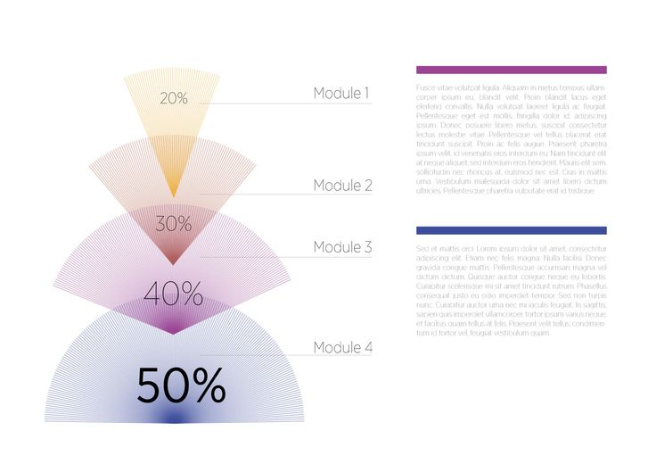
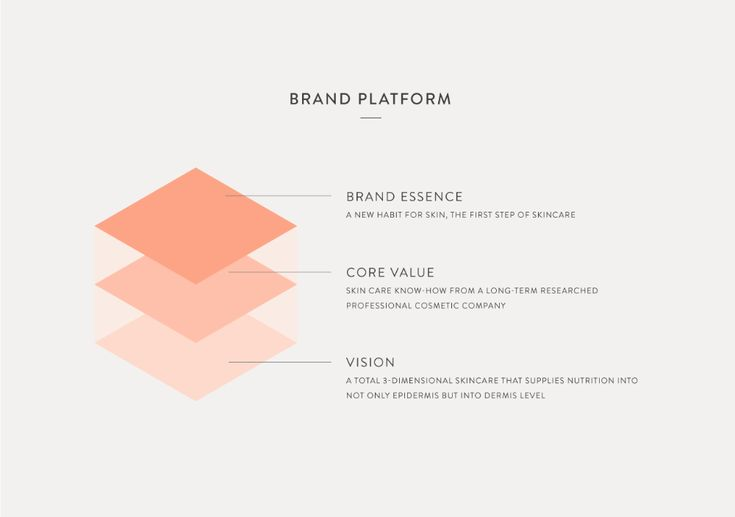

# Título del contenido de la Sesión 1

## 1. Primer tema

Escribe aquí la explicación del primer tema. 



*Nota.* Imagen random de Pinterest. Cámbiala guardando tu imagen en `assets/images/s1/` y cambiando la ruta de arriba.

### Una lista numerada

1.  **Paso uno**: descripción del paso.
2.  **Paso dos**: descripción del paso.
3.  **Paso tres**: descripción del paso.

## 2. Segundo tema

Así se muestra código en la página:

``` python
import pandas as pd

df = pd.read_csv("mis_datos.csv")
df.head()
```



*Nota.* Imagen random de Pinterest. Si la imagen viene de otra fuente, cítala con un link: De [*Título de la fuente*](https://www.ejemplo.com), por Autor, Año.

### Una tabla

| # | COLUMNA |
|:-:|----------------------|
| 1 | Primer elemento |
| 2 | Segundo elemento |
| 3 | Tercer elemento |
